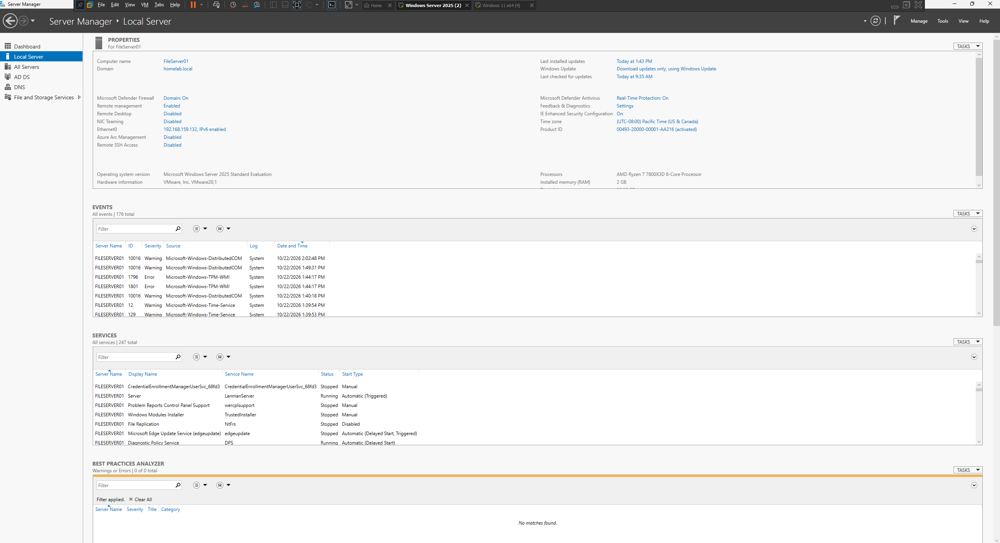
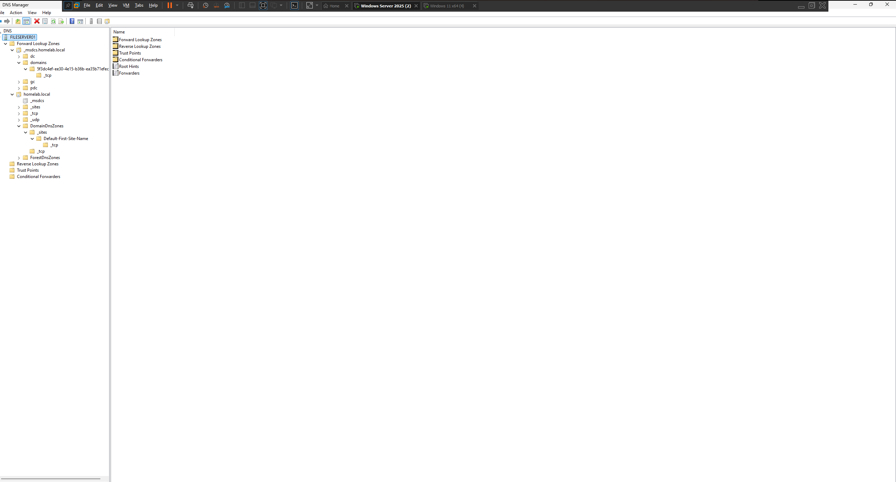
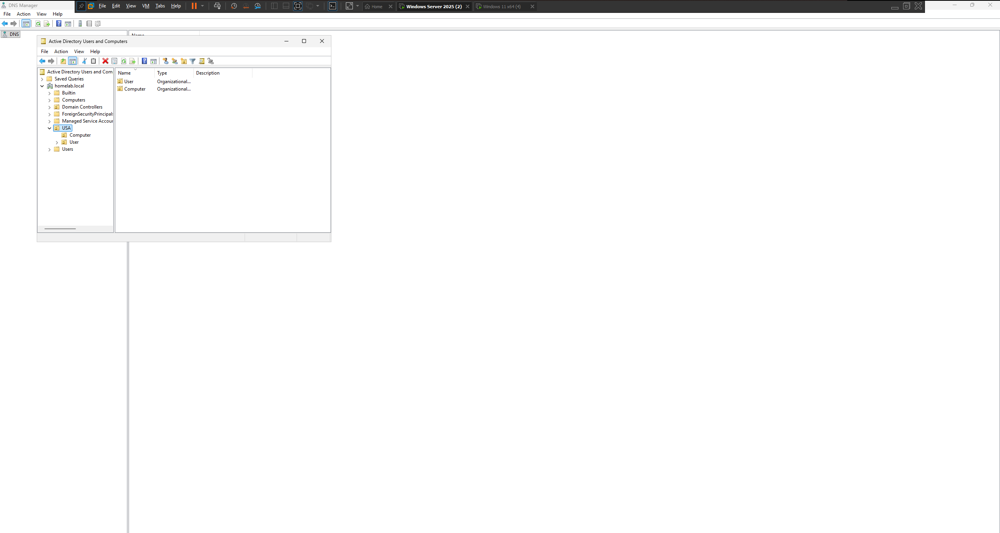
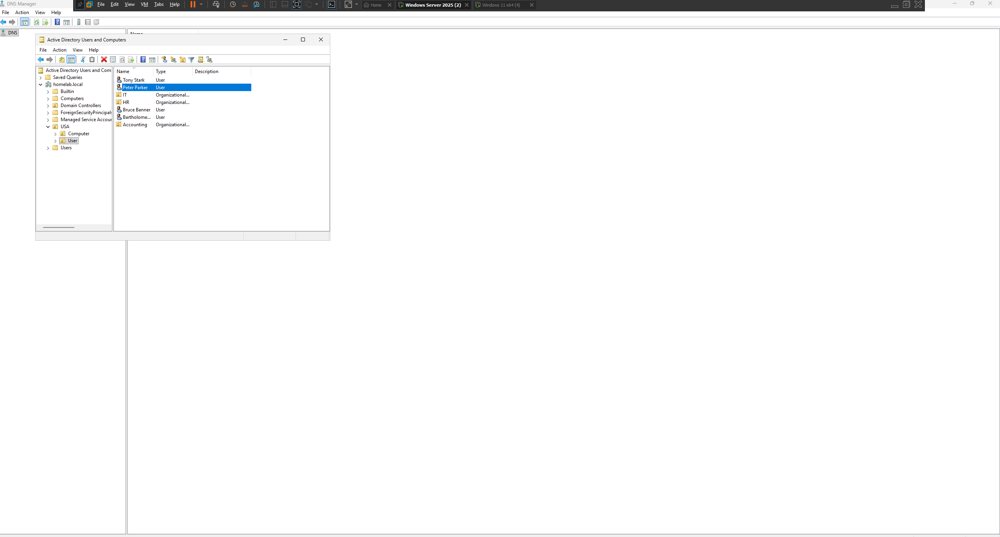
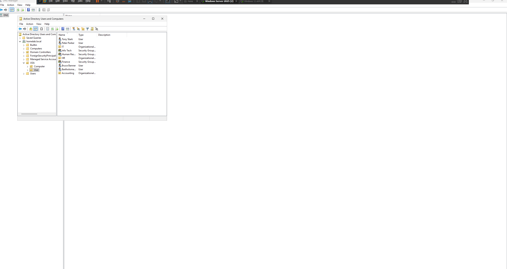
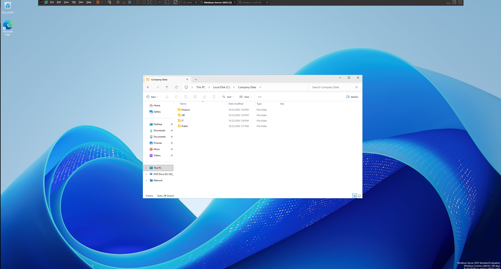
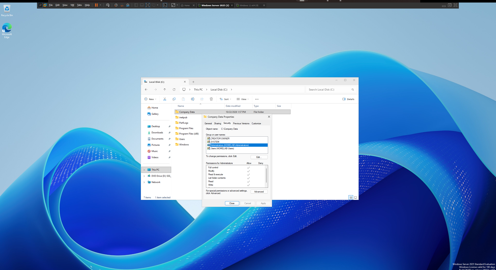
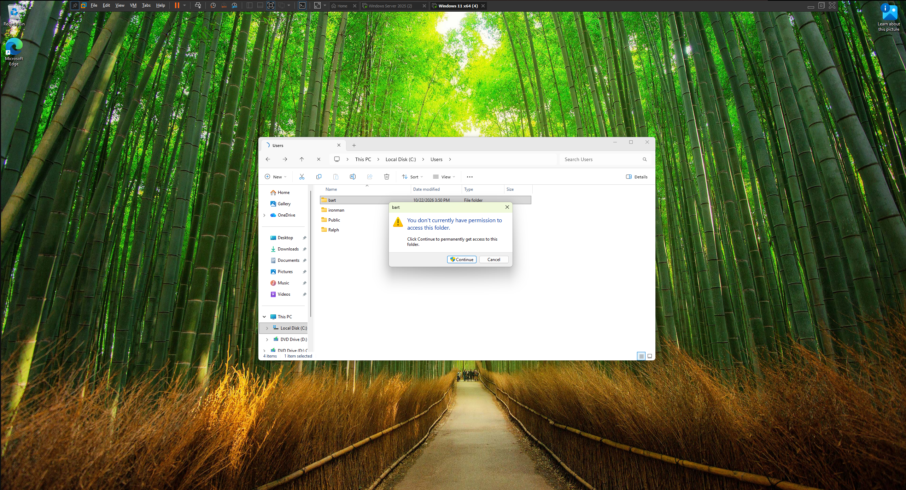

# Enterprise Active Directory & Windows Server 2025 Homelab

**Technologies:** Windows Server 2025 | Active Directory | Windows 11 | VMware | File Services | Access Control

## Project Overview

Designed and deployed a virtualized Windows enterprise environment using VMware to demonstrate hands-on experience with centralized identity management, domain administration, network file sharing, and access control.

The infrastructure consists of two virtual machines:

- **Windows Server 2025:** Domain Controller, Active Directory Domain Services (AD DS), DNS, and File Server.
- **Windows 11:** Domain-joined client workstation used to validate authentication, network connectivity, and resource access.

## 1. Windows Server & Active Directory Deployment

- Installed and configured Windows Server 2025 within VMware.
- Deployed Active Directory Domain Services and promoted the server to a Domain Controller.
- Configured domain infrastructure to support centralized authentication and identity administration.

**Windows Server Configuration**

**Domain Controller**

**DNS Configuration**

## 2. Identity & Access Management

- Created and organized Active Directory Organizational Units (OUs) to simulate departmental structures.
- Provisioned domain user accounts and configured security groups to support identity administration.
- Established a structured directory environment for managing user identities and access permissions.

**Organizational Units**

**Domain User Accounts**

**Security Groups**

## 3. Windows 11 Domain Integration

- Deployed a Windows 11 virtual machine within the VMware environment.
- Joined the workstation to the Active Directory domain.
- Verified domain connectivity and authenticated access to network resources.

## 4. File Server & Access Control

- Configured Windows file-sharing services on Windows Server 2025.
- Created shared directories and established share-level and NTFS permissions.
- Assigned access rights to domain users and groups to control resource availability.
- Tested permissions from the Windows 11 client to verify authorized and restricted access.

**Shared Folder Configuration**

**Share Permissions**

**NTFS Permissions**

## 5. Security Validation & Testing

Performed access control testing using domain user accounts with different permission levels to verify that security restrictions were properly enforced.

- **Authorized Access:** Confirmed permitted users could access assigned network resources.
- **Unauthorized Access:** Verified restricted users were denied access to protected resources.

**Authorized User Test**

**Unauthorized User Test**

## Technical Skills Demonstrated

- **Systems Administration:** Windows Server 2025, server roles, and infrastructure configuration.
- **Identity Management:** Active Directory, user provisioning, Organizational Units, and security groups.
- **Networking:** VMware virtualization, DNS, domain integration, and client-server communication.
- **Security:** NTFS permissions, share permissions, access control, and authorization testing.
- **Troubleshooting:** Windows networking, domain connectivity, and resource access validation.

## Project Outcome

Successfully implemented a functional Active Directory environment integrating centralized user administration, a domain-joined Windows 11 workstation, and permission-controlled network file sharing.

Validated system functionality through authentication, network connectivity, and access control testing, demonstrating practical experience with enterprise Windows infrastructure and identity management.
